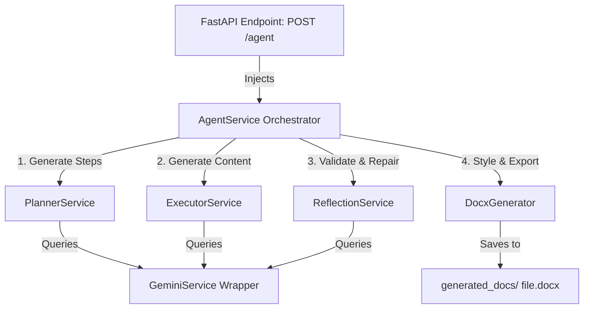

# Autonomous AI Agent Document Generator

An enterprise-grade Python application built using Clean Architecture principles. It exposes a FastAPI endpoint that receives natural language requests, plans and executes tasks using the Gemini API, performs self-reflection and auto-correction checks, and compiles the final verified draft into a styled, professional Microsoft Word (.docx) document.

---

## Project Overview

The Autonomous AI Agent accepts a prompt requesting a document type (e.g., meeting minutes, business proposal, technical report), analyzes the prompt, dynamically builds a list of milestone steps, generates markdown content for each milestone, audits the consolidated content against structure criteria, repairs any missing sections, and formats the output into a branded Word document stored inside `generated_docs/`.

---

## Architecture

This application strictly conforms to **Clean Architecture** patterns:
- **Presentation Layer (`app/api`)**: Exposes HTTP endpoints and resolves service components using FastAPI Dependency Injection. Contains zero business logic.
- **Orchestration Layer (`app/services`)**: Houses the `AgentService` which coordinates the overall agent workflow (Planner -> Executor -> Reflection -> Document Generator).
- **Core Domain & Models (`app/models`)**: Defines type configurations and constraints using Pydantic data validation rules.
- **Engines (`app/planner`, `app/executor`, `app/reflection`, `app/document`)**: Contains decoupled logic for specific domains. Decoupled from the Gemini SDK via a wrapper service (`GeminiService`).
- **Resilience**: Configured with asynchronous retry policies, custom exceptions, and structured rotating logging.



---

## Folder Structure

```text
c:/Users/sondr/OneDrive/Desktop/TODO/
├── app/
│   ├── api/                  # API routers and dependency injection providers
│   │   ├── __init__.py
│   │   ├── deps.py           # Dependency injections definitions
│   │   └── endpoints.py      # POST /agent, GET /health endpoints
│   ├── core/                 # Shared core frameworks
│   │   ├── __init__.py
│   │   ├── exceptions.py     # Custom exceptions and global handlers
│   │   ├── logging.py        # Stream & Rotating log file handlers configuration
│   │   └── settings.py       # Configuration settings loading (pydantic-settings)
│   ├── document/             # Margins, styling, and python-docx layout configurations
│   │   ├── __init__.py
│   │   ├── base.py
│   │   └── docx_generator.py
│   ├── executor/             # Iterative step execution logic
│   │   ├── __init__.py
│   │   ├── base.py
│   │   └── step_executor.py
│   ├── models/               # Domain data entities and Pydantic models
│   │   ├── __init__.py
│   │   ├── agent.py          # Request, Response, and Step models
│   │   └── document.py
│   ├── planner/              # Execution plan steps generation
│   │   ├── __init__.py
│   │   ├── base.py
│   │   └── gemini_planner.py
│   ├── reflection/           # Section completeness checks & dynamic repairs
│   │   ├── __init__.py
│   │   ├── base.py
│   │   └── self_reflection.py
│   ├── services/             # Orchestrating pipelines & Gemini wrapper
│   │   ├── __init__.py
│   │   ├── agent.py          # AgentService workflow
│   │   └── gemini.py         # GeminiService wrapper with retry handling
│   ├── utils/                # General utility folders
│   │   ├── __init__.py
│   │   └── helpers.py
│   └── main.py               # Application entry point
├── generated_docs/           # Generated Word documents (.docx) storage
├── logs/                     # Rotating app logs output (app.log)
├── .env                      # Loaded environment configuration secrets
├── .env.example              # Environment variables template
├── requirements.txt          # Package requirements list
└── pyproject.toml            # Poetry / project configurations
```

---

## Requirements

- **Python**: Version 3.12 or above.
- **FastAPI**: Backend web framework.
- **Pydantic / Pydantic-Settings**: For validation and settings.
- **Python-Docx**: Document styling, footer compilation, and margins setting.
- **Google Generative AI**: Google Gemini Free API SDK client.

---

## Installation

1. **Clone or copy the workspace directory**.
2. **Set up a Virtual Environment**:
   ```bash
   python -m venv .venv
   source .venv/bin/activate  # On Windows: .venv\Scripts\activate
   ```
3. **Install Dependencies**:
   ```bash
   pip install -r requirements.txt
   ```
4. **Create Environment Variables**:
   Copy `.env.example` to `.env` and fill in your Gemini API key:
   ```bash
   cp .env.example .env
   ```

---

## Environment Variables

The application reads variables using `pydantic-settings` from `.env`:

```env
# Project Metadata
PROJECT_NAME=autonomous-docx-agent
VERSION=0.1.0

# Server Configuration
HOST=0.0.0.0
PORT=8000
LOG_LEVEL=info

# AI API Configurations
GEMINI_API_KEY=your_gemini_api_key_here
GEMINI_MODEL=gemini-1.5-flash

# Document & Storage Configurations
DOCUMENT_FOLDER=generated_docs

# Validation Settings (comma-separated required headers)
VALIDATION_REQUIRED_SECTIONS=Executive Summary,Introduction,Timeline,Budget,Conclusion
```

---

## Running FastAPI

To run the local server in development mode:
```bash
uvicorn app.main:app --reload --host 0.0.0.0 --port 8000
```
Once started, the interactive API documentation pages are accessible at:
- **Swagger UI**: [http://127.0.0.1:8000/docs](http://127.0.0.1:8000/docs)
- **ReDoc**: [http://127.0.0.1:8000/redoc](http://127.0.0.1:8000/redoc)

---

## Testing API

### Sample Request
Submit a request using `curl`:
```bash
curl -X POST "http://127.0.0.1:8000/agent" \
     -H "Content-Type: application/json" \
     -d '{"request": "Create a business proposal for implementing an AI chatbot in a hospital."}'
```

### Sample Response
```json
{
  "status": "success",
  "plan": [
    "1. Analyze chatbot request",
    "2. Identify healthcare requirements",
    "3. Draft business proposal details",
    "4. Review proposal against criteria",
    "5. Compile Word document"
  ],
  "document": "generated_docs/report_39515ca6.docx",
  "execution_log": [
    "Planning phase: Initializing planner to analyze request.",
    "Planning phase: Plan generated with 5 steps.",
    "Execution phase: Commencing plan step execution.",
    "Plan execution complete.",
    "Reflection phase: Reviewing and critiquing output content.",
    "Reflection phase: Reflection check passed = True.",
    "Document generation phase: Creating Word document (.docx).",
    "Document generation phase: Document saved successfully."
  ]
}
```

---

## Reflection Improvement

### Why Reflection Improves Autonomous Reasoning:
1. **Closed-Loop Verification**: Raw LLM generation is open-loop. Reflection adds a feedback loop, checking the generated text against explicit rules (e.g. required headers like `Budget` or `Timeline`) before finalizing.
2. **Self-Correction**: Instead of failing or omitting sections when prompts lack parameters, the reflection layer detects missing requirements and automatically queries Gemini to generate content patches.
3. **Downstream Quality Gatekeeping**: Prevents unstructured/incomplete content from leaking into the compiler engine (`python-docx`), ensuring all compiled documents adhere to corporate document standards.

---

## Future Improvements

- **Parallel Step Execution**: Run independent plan steps concurrently to reduce generation latency.
- **Custom Docx Templating**: Load pre-existing Word templates (`.dotx`) for corporate branding (header logos, colors).
- **Plan Adjustment Loop**: Enable the executor to dynamically change the plan mid-flight if a step fails or if new information is discovered.
- **State Persistence**: Store agent execution plans, logs, and generated files in a database (like PostgreSQL/SQLite) for progress tracking and resumable runs.
